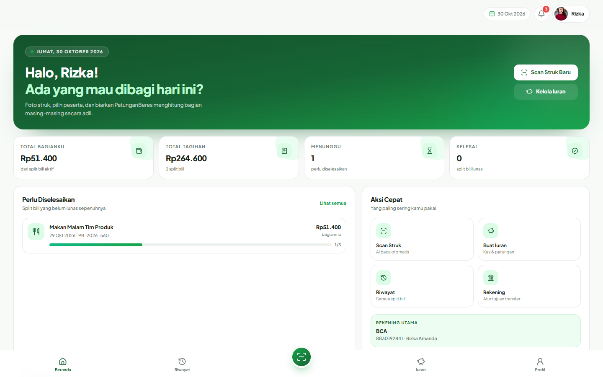
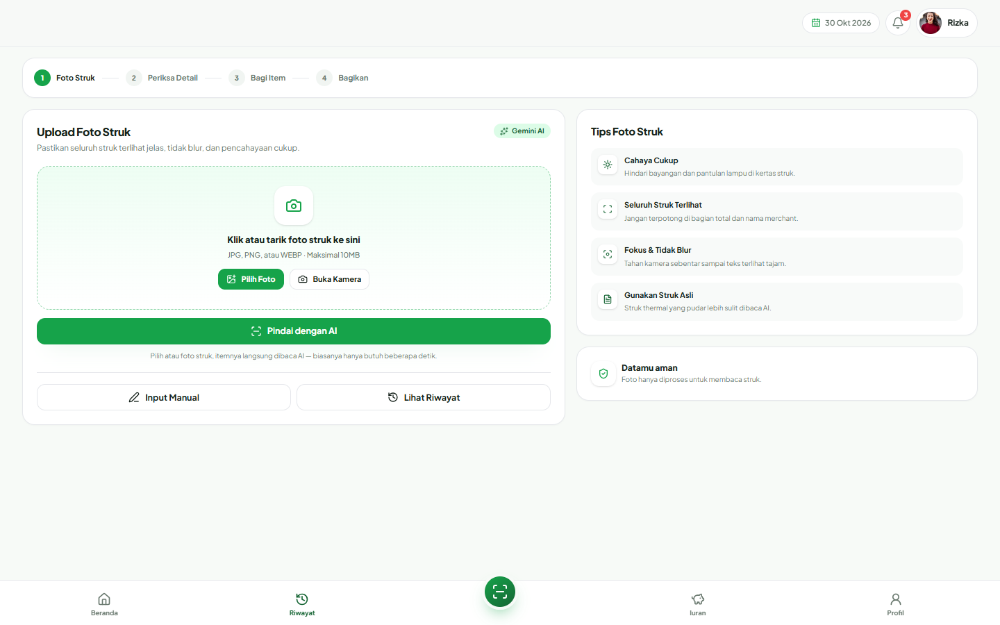
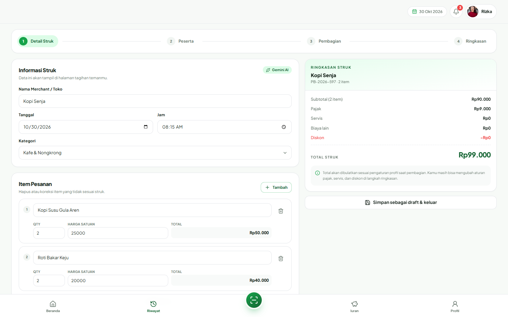
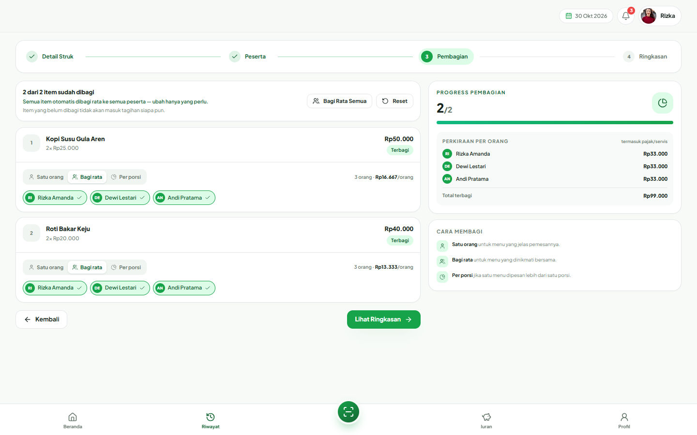
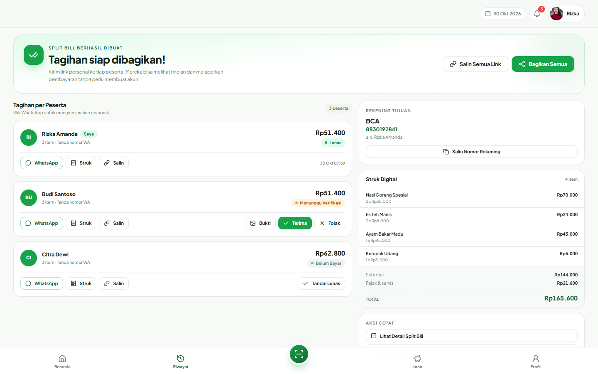
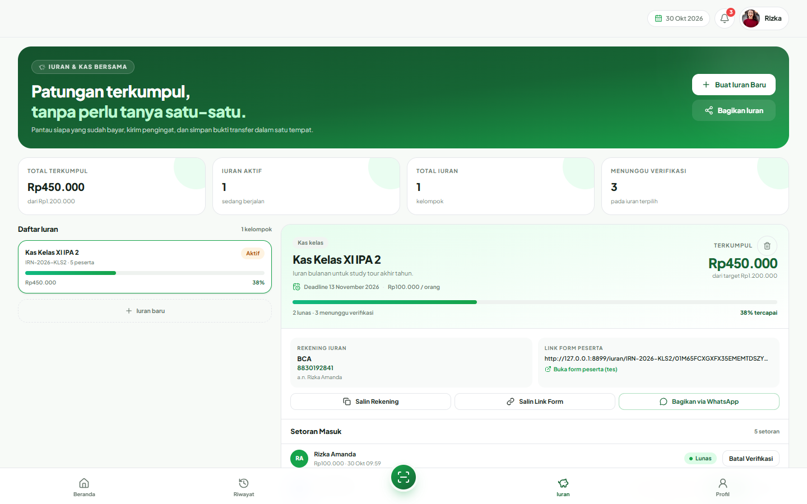
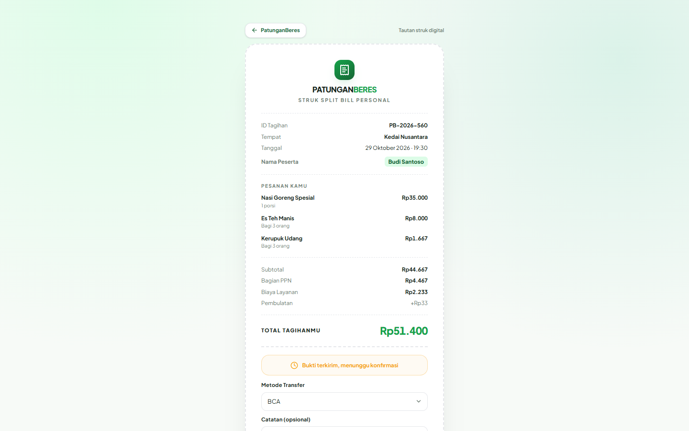
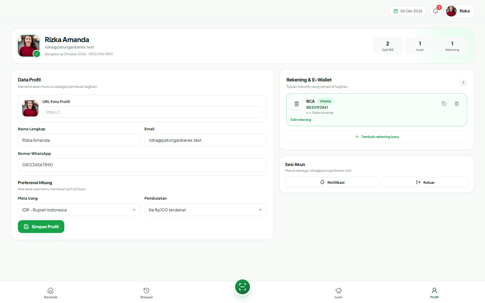

# PatunganBeres

[](https://github.com/aiininratnadwitanti/patunganberes/actions/workflows/tests.yml)


Aplikasi split bill dan iuran bersama: scan struk dengan AI, hitung PPN & service secara transparan, lalu bagikan struk digital personal ke tiap peserta.

Aplikasi ini adalah **project Laravel 12** (MySQL) yang berada di dalam folder [`laravel/`](./laravel). Seluruh kode berada di sana (routes, controllers, models, Blade views, migrations, dan tests).

## Preview

<table>
  <tr>
    <td width="50%"><br><sub><b>Dashboard</b> — ringkasan patungan & aksi cepat</sub></td>
    <td width="50%"><br><sub><b>Scan struk</b> — foto struk, AI membaca itemnya</sub></td>
  </tr>
  <tr>
    <td width="50%"><br><sub><b>Periksa detail</b> — koreksi item hasil scan</sub></td>
    <td width="50%"><br><sub><b>Bagi item</b> — per orang / bagi rata / per porsi</sub></td>
  </tr>
  <tr>
    <td width="50%"><br><sub><b>Tagihan & link</b> — link personal tiap peserta</sub></td>
    <td width="50%"><br><sub><b>Iuran bersama</b> — satu link form, progres terkumpul</sub></td>
  </tr>
  <tr>
    <td width="50%"><br><sub><b>Struk digital</b> — tampilan peserta, tanpa akun</sub></td>
    <td width="50%"><br><sub><b>Profil</b> — identitas & rekening tujuan transfer</sub></td>
  </tr>
</table>

## Fitur

- **Wizard split bill** — upload/scan struk, periksa item, pilih peserta, bagi item (per orang / bagi rata / per porsi), lalu ringkasan.
- **AI receipt scanner** — memakai Google Gemini untuk membaca struk.
- **Kalkulasi adil** — pajak, service charge, diskon, biaya lain, dan pembulatan yang bisa diatur per tagihan.
- **Struk digital personal** — tiap peserta mendapat tautan guest untuk melihat rincian dan melaporkan pembayaran tanpa akun.
- **Iuran bersama** — bagikan satu link form ke seluruh peserta; tiap orang mengisi nama, nominal, dan bukti setoran. Nominal langsung mengurangi sisa target, setoran boleh melebihi target (ditandai "Melebihi target"), lalu pembuat memverifikasi buktinya.
- **Notifikasi, riwayat, arsip, duplikasi, dan profil rekening.**

> Aplikasi ini **tidak menyertakan data contoh apa pun**. Semua akun dan data dibuat oleh pemakai lewat registrasi dan alur aplikasi.

## Persyaratan

- PHP 8.2+
- Composer 2
- MySQL 8+ (default) atau SQLite
- Node.js hanya dibutuhkan jika memakai `composer run dev` (opsional)

## Menjalankan

```bash
cd laravel

composer install
cp .env.example .env
php artisan key:generate
```

### Siapkan database MySQL

```bash
mysql -u root -e "CREATE DATABASE patunganberes CHARACTER SET utf8mb4 COLLATE utf8mb4_unicode_ci;"
```

Sesuaikan kredensial di `laravel/.env` bila perlu:

```env
DB_CONNECTION=mysql
DB_HOST=127.0.0.1
DB_PORT=3306
DB_DATABASE=patunganberes
DB_USERNAME=root
DB_PASSWORD=
```

### Migrasi, storage link, dan jalankan

```bash
php artisan migrate

# Tautan penyimpanan untuk foto struk & bukti pembayaran
php artisan storage:link

php artisan serve
```

Buka <http://localhost:8000>, lalu **daftar akun baru** di halaman *Daftar*.

## AI Receipt Scanner

Fitur scan struk membutuhkan Gemini API key. Isi di `laravel/.env`:

```env
GEMINI_API_KEY=your-key
GEMINI_MODEL=gemini-3-flash-preview
GEMINI_FALLBACK_MODELS=gemini-3.1-flash-lite,gemini-3.1-flash-lite-preview,gemini-3.6-flash,gemini-3.5-flash
```

Model utama dicoba lebih dulu, lalu model cadangan pada `GEMINI_FALLBACK_MODELS`,
sebelum menampilkan pesan error. Foto struk otomatis dikompres sebelum dikirim
sehingga pemindaian berlangsung cepat.

> **Kuota free tier terbatas** — Google memberi sekitar 20 permintaan/hari **per model**.
> Daftar model cadangan memperbesar kuota harian total. Untuk pemakaian rutin,
> aktifkan billing pada Google AI Studio agar kuota tidak cepat habis.

Tanpa key (atau bila layanan AI gagal), proses scan akan menampilkan pesan error yang jelas dan mengarahkan pemakai ke **input manual** — tanpa crash dan tanpa data palsu.

## Pengujian

```bash
cd laravel
php artisan test
```

Secara default test berjalan di SQLite in-memory agar cepat dan portabel. Test yang sama juga dijalankan otomatis di CI (GitHub Actions) pada setiap push dan pull request.

Untuk menjalankan terhadap MySQL, buat database test lalu set env:

```bash
mysql -u root -e "CREATE DATABASE patunganberes_test CHARACTER SET utf8mb4 COLLATE utf8mb4_unicode_ci;"

# Windows PowerShell
$env:DB_CONNECTION='mysql'; $env:DB_DATABASE='patunganberes_test'; php artisan test
```

## Struktur folder

```
laravel/
├── app/
│   ├── Http/Controllers/   # Auth, Dashboard, SplitBill, Iuran, dll.
│   ├── Models/             # Eloquent models
│   ├── Services/           # SplitBillCalculator, ReceiptScannerService
│   └── Support/helpers.php # Helper format rupiah & pesan WhatsApp
├── database/
│   ├── migrations/
│   ├── factories/
│   └── seeders/
├── docs/screenshots/       # Gambar untuk README
├── resources/views/        # Blade views (layouts, partials, halaman)
├── public/css|js           # Aset statis (CSS + Alpine.js, tanpa build step)
├── routes/web.php
└── tests/
```

## Catatan teknis

- Ditulis dengan **Laravel murni** (Blade + server-side).
- Frontend interaktif memakai **Alpine.js** dan **Tailwind (play CDN)**; tidak ada langkah build yang diperlukan.
- Halaman publik `GET /receipt/{code}/{token}` menerima `code` tagihan dan `token` unik milik peserta, sehingga tautan tidak mudah ditebak.
- Semua query dibatasi ke data milik pemakai yang login (isolasi antar akun diuji di test suite).
- Endpoint publik (form setoran iuran, laporan pembayaran) dan login/register dibatasi rate limit.

## Lisensi

MIT
